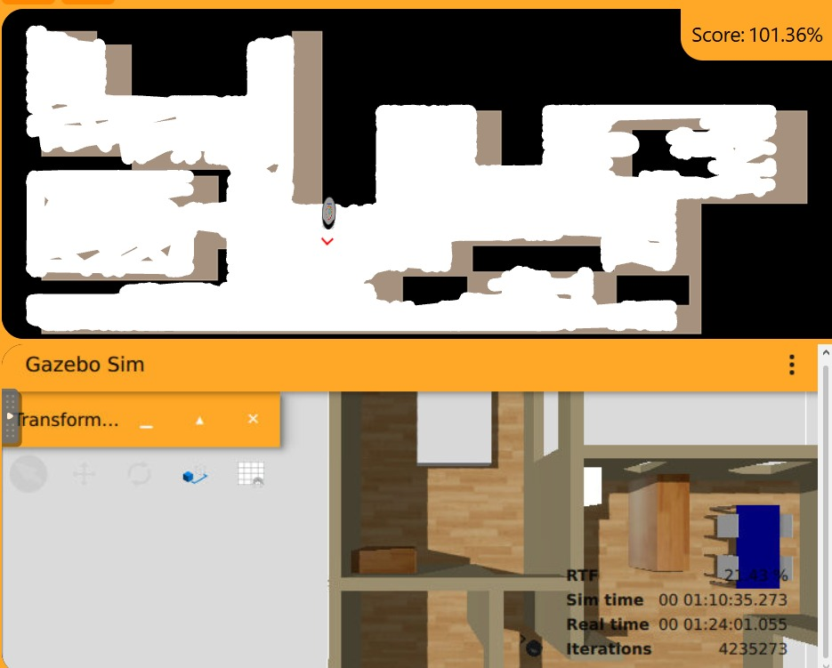
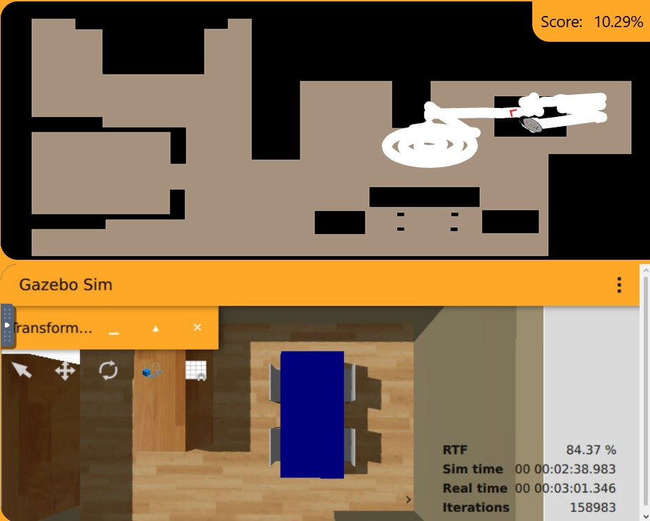
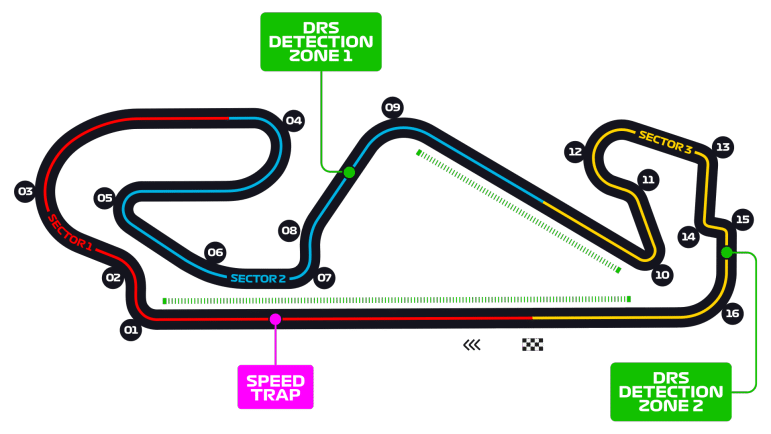
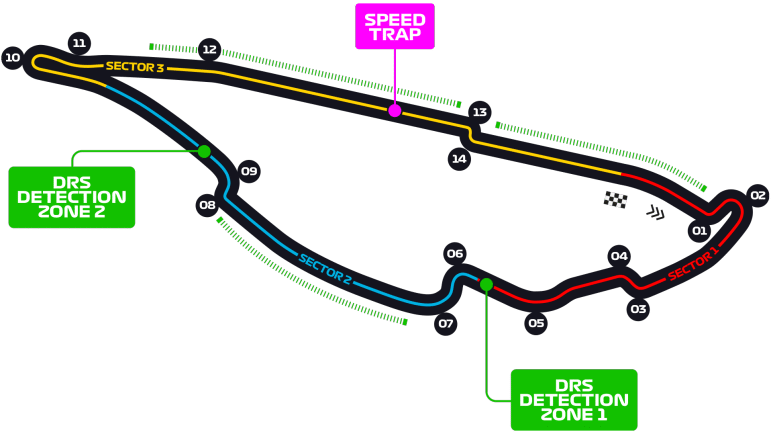

# PRACTICA 1
## Navegación de un robot aspiradora de gama baja
Lo primero que he pensado para poder realizar esta practica es mirar que _import_ son necesarios para poder usar esas librerias para que el robot funcione. Una vez visto los _import_ defino el tipo de algoritmo que me gustaria usar para realizar esta practica. En este caso se nos da como algoritmo obligatorio el algoritmo de **espiral**, el cual he usado pero aplicandole una pequeña modificación ya que no aplica el comando de espiral constantemente.\
\
Pero antes de aplicar el algortimo al codigo y probarlo, defino la tabla de estados que voy a tener en el codigo. En mi caso hago una tabla con 4 estados:\
    - **SPIRAL** (Este es un añadido ya que es el algoritmo y en el enunciado se nos dice que nuestro codigo tiene que tener al menos 3 estados, que son los siguentes que menciono)\
    - **DASH**\
    - **TURN**\
    - **BACK**\
\
En mi caso he planteado que empieze con el estado de espiral, pero despues de chocarse o encontrar un objeto simplente avanza. Pero planteo dos situaciones por tiempo:\
    - En menos de 8 segundos: Si antes de 8 segundos el robot encuentra otro objeto, el tiempo se reinicia y vuelve a aplicar el estado de volver hacia atras, girar sobre si mismo y finalmente avanzar hacia delate.\
    - Justo en 8 segundos: En caso de que el tiempo llegue a 8 segundos sin encontrar un obstaculo, procede ha iniciar de nuevo ese estado de espiral.\
\
Una vez ya tengo la estructura del código paso a crearlo, dandole forma con funciones y dando unos valores genericos (ya que todavia no hemos procedido ha hacer una prueba experimental y no sabemos que valores asignarle a cada cosa para que el funcionamiento del robot sea el más óptimo).
### Explicación de funciones
`elapsed()`
\
Esta función cuenta el tiempo que lleva el robot en ese estado, dicho de otra forma es un cronometro.\
`obstacle()`
\
Esta función hace uso de los laser del robot para la detección de objetos. La funcion devuelve TRUE o FALSE segun lo que detecten los rayos. En caso de que el rayo no detecte nada devuelve FALSE, y en caso de que el rayo detecte un objeto y ese objeto este dentro de la distancia definida devuelve TRUE.
\
`on_enter()`
\
Esta función se ejecuta una _unica vez_ cada vez que se realiza un cambio de estado. Dento de la función se realiza el cambio de estado, reinicia el cornometro para la funcion `elapsed()` y en caso de que el estado al que cambie sea **TURN** valora el tiempo de giro y la dirección de giro. Implementando asi la aleatoriedad para no repetir el mismo giro y por ende entrar en un bucle pasando por los mismo sitios.

### Ejecución
Finalmente el código ejecuta un bucle infinito, en el que ejecuta cada estado de la tabla de estados y en el que se ejecuta la función `on_enter()` para poder realizar el cambio de estados. Dentro del bucle tengo una funcion llamada `Frequency.tick()` que lo que hace es que mantenga el bucel en ejecución a 20Hz, o dicho de otra forma que se realizen 20 iteraciones por minuto.

> [!NOTE]
También podemos llegar a ver que a lo largo de la simulación y debido a mi planteamiento, el robot de vez en cuando, se queda pillado en las esquinas o debajo de la mesa. Esto he llegado a la conclusión de que se ha podido deber a que la lectura de los laser no es siempre correcta, es decir que el laser no detecta el objeto o en caso de que lo detecte lo detecta muy lejos, devolviendo FALSE y causando que hasta que no pasen los 8 segundo del "cronometro" que tengo puesto en mi codigo para realiza el cambio al estado de **SPIRAL** no reinicia el estado de los laser hasta que no gira lo suficiente hasta que el estado cambie a TRUE.
### Video
Video recotado a velocidad normal: [https://youtu.be/PzVDCNYzic8]\
Video recotado a velocidad x2: [https://youtu.be/t6TosIpqG64]
> [!NOTE]
El video esta grabado cada 5/15 minutos debido a que para completarlo al 100% en esta tanda tomaria más de dos horas. En otro par de pruebas el robot ha tardado en limpiar el 100% al rededor de 1 hora/ 1 hora y 20. Pero al ser un archivo tan grande y tan pesado he tomado la decisión de acortarlo.
### Imagen Resultado de la Prueba
Durante varias pruebas cambiando tanto el codigo como los datos experimentales para la ejecución, en el caso de la imagen el código en uso es el presentado en la entrega, vemos que el robot ha logrado realizar la limpieza al 101% en aproximadamente 1 hora y 22 minutos.
\
\

> [!NOTE]
Al realizar las pruebas he podido notar que en el simulador 2D donde solo se ve el borde de las zonas no es del todo correcto ya que vemos que la mesa de arriba a la izquierda aparecene en horizontal cuando en el simulador 3D aparece en vertical. Ademas de que podemos ver que al ser una mesa el robot alguna que otra vez entra debajo para limpiar a pesar de que en el mapa 2D se identifica como objeto solido. Finalmente otra anotación a relalizar es que en el mapa 2D la zona que va apareciendo limpia sale "desplazada", con esto me refiero a que en el lado derecho del mapa queda libre como un centimetro mientras que en el lado izquiedo se sale un centimetro. Ademas que al compararlo con el 3D en este ultimo la pared no coincide con el del mapa 2D y a pesar de que en el mapa 2D se ve representado como que todavia hay huecom en el 3D vemos como se choca con la pared.

### Imagen Robot debajo de la mesa

# Practica 2
## F1 sigue lineas
De nuevo y al igual que en la primera practica lo primero que debemos de hacer es mirar que _include_ son necesarios para poder realizar esta practica. En este caso primero me he puesto a indagar sobre como funciona la camara y detalles importantes a tener en cuenta. Durante mi busqueda de información he descubierto que la camara tiene algo llamado **ROI** o dicho de otra forma _regions of interest_. Y en este caso nosotros vamos a seleccionar no una, si no dos (esto se explicara un poco más adelante). Puesto de una forma en la que se entienda facil, si dividiesemos la zona de la camara en 5 regiones en horizontal obtendriamos obtendriamos 5 rectangulos de visión. En mi caso he decidido escoger el que sería el segundo rectangulo y el cuarto, definidos por un rango de [250, 320] y de [330, 400]. La razón por la que escogo dos ROI es debido a que en el código implemento una comparativa enter las dos regiones para verificar si la linea sigue recta o si se curva, y para en consecuencia actuar antes de la curva/giro y evitar que asi el robot siga recto estrellandose con la pared y perdiendo la linea.\
\
A lo largo de la practica he relaizado diferentes ensayos y errores con respecto a la velocidad y lo PID (que en mi opinión era lo que podriamos considerar lo mas complicado de la practica). Esto de debe a que al inicializar con PID bajos y una baja velocidad, no se generaban errores de perdida de linea o de oscilación. Pero a medida que iba avanzando y perfeccionando todo en busqueda de que el F1 pudiese hacer las vueltas cada vez más rápido generaba todo tipo de escenarios, tales como: Que se saliera ocasionando que pierda la linea y quedandose pillado en la pared u oscilaciones indevidas en los tramos de rectas, ya sean al comienzo o después de una curva.

### Explicación de funciones
En este caso he hecho uso de una clase, ya que a lo largo de las iteraciones del bucle preciso guardar la información previa y después modificarla. Asi me aseguro que el código es más limio y ordenado, aparte de que asi no tengo que tener variables en exceso para estar guardando esos dato y despues tener que trasladarlos de vuelta.
En la clase `PID` tenemos diferentes funciones.\
`__init__()`
\
Esta función es para el guardado de datos en cada ciclo del bucle.
`reset()`
\
Como dice el nombre, reinicia el valor de la interal, el valor previo y de la derivada filtrada.
`update()`
\
Esta función calcula la salida del PID: calculando la integral, la derivada, aplicando el filtro, guardando el error actual y devolviendo el calculo completo.
\
Luego tenemos las dos funciones para el uso de la cámara.\
`red_mask_hsv()`
\
Esta función principalmente recibe la imagen de la camara en formato BRG y lo convierte en formato HSV. Dentro de la propia función se hace un recorte de la imagen, además de lo mencionado previamente de la transformación para facilitar el aislamiento del color. Aparte dentro hago uso de dos tonalidades distntas de **ROJO** por si dentro de la simulación (que no debería) hubiese alteraciones de luz y con ello diferentes tonalidades de rojos, y tambien se realiza la limpieza de ruido (como los pianos o pixeles pequeños sueltos de rojo) y si le llegara a faltar pixeles rojos a la linea tambien los rellena.\
`line_error()`
\
Esta función principalmente calcula en que ROI se encuentra la linea roja. Para ello calcula en que fila se encontraria la linea para luego calcular el momento de la imagen. En caso de no encontrar o que el area sea menor la función devuelve NONE. También, normaliza entre rango de [-1, 1] para saber si la linea se encuentra a la izquierda(número negativo), derecha(número positivo) o en el centro (0). Para finalmente devolver las coordenadas de donde se encuentra la linea.\
 
Además de tener una tabla de estados que se compone de: los dos controladores de PID, el ultimo lado en el que se vio la linea, las últimas ordenes, el instante en el que se perdio la linea y el instante de la iteración(para calcular el tiempo desde la última iteración).\
 
Finalmente tenemos el bucle principal donde iniciamos la preparación, ajustamos la visión, calculamos el error de giro (si hubise muchas lineas) y valoramos cada caso: Si esta la linea y a que velocidad va dependiendo de si es recta o una curva, y si no encuentra la linea. 

### Videos
Video del circuito de Simple: [https://youtu.be/IfMB1JLAPts]\
\
Video del circuito de Montmelo: [https://youtu.be/l0xxpVgCPBU]\
\
Video del circuito de Motreal: [https://youtu.be/nsu8jjcZmZ4]\
\
Video del circuito de Nurburgring: [https://youtu.be/FFFQ01d16ko]
# Práctica 3
## Navegación de un F1 con el sistema de navegación local VFF para la esquiva de obstaculos
En esta práctica el objetivo es que el F1 siga una serie de waypoints a lo largo del circuito evitando los obstáculos usando únicamente el **láser**. Se nos pide que para realizar la practica se haga con el sistema de navegación local **VFF** (_Virtual Force Field_), que consiste en tratar al coche como si fuese una partícula sometida a varias fuerzas virtuales: una **fuerza de atracción** que lo empuja hacia el siguiente waypoint y una **fuerza de repulsión** que lo aleja de los obstáculos. La suma de ambas nos da el vector de dirección que debe seguir el coche.\
 \
Los `import` necesarios son los mismos que en las practicas anteriores: `math` para todos los cálculos trigonométricos, y `HAL`, `WebGUI` y `Frequency` para comunicarnos con el robot (sensores y motores), con la interfaz web (waypoints y depuración visual) y para controlar la frecuencia del bucle.\
 \
Al igual que en la práctica anterior, lo más complicado ha sido el ajuste de parámetros. Ya que al inicio he puesto variables muy altas que hacían que el F1 se estrellara, y después de modificar varias veces el propio código para evitar los choques y el que el F1 se quedara pillado entre un coche y la pared, me he encontrado con el problema de que el F1 me oscilaba en todo momento. Para ello he tenido que modificar la variables pero me encontraba con el mismo problema, el coche coge el camino más pequeño. Para ello he realizado una última modificación, que consistía en añadir una función que verificaba el hueco libre a la izquierda y a la derecha y escogía el más amplio. Y junto con esa modificación le he dado menos "importancia" o mejor dicho menos peso a los lasers situados más a los extremos para evitar las oscilaciones.
### Explicación de funciones
En este caso no he usado clases, ya que cada función es una operación matemática concreta que no necesita guardar información entre iteraciones. Los pocos datos que sí hay que recordar (el waypoint actual, el vector filtrado, la W anterior y el último lado elegido) las guardo como variables globales fuera del bucle.\
 \
`clamp()`
\
Función auxiliar que limita un valor entre un mínimo y un máximo. Se usa en muchos puntos del código (velocidad angular, factores de velocidad, urgencia...).\
 \
`parse_laser_data()`
\
Recibe los datos del láser y los convierte en una lista de pares (distancia, ángulo). El ángulo 0 es el frente del coche, los ángulos positivos son hacia la izquierda y los negativos son hacia la derecha. Las medidas inválidas (`NaN` o menores o iguales a 0) se transforman en distancia infinita para que no se tengan en cuenta como obstáculos.\
`absolute2relative()`
\
Transforma unas coordenadas absolutas al sistema de referencia del coche, aplicando una traslación y una rotación según la posición y orientación del robot. Es necesaria porque el waypoint nos lo dan en coordenadas absolutas pero las fuerzas hay que calcularlas desde el punto de vista del coche.\
`target_vector()`
\
Calcula la **fuerza de atracción**: obtiene la posición del waypoint, la pasa a coordenadas relativas y devuelve el vector normalizado junto con la distancia al objetivo. Normalizarlo hace que la atracción sea constante y no dependa de lo lejos que esté el waypoint.\
 \
`obstacle_vector()`
\
Calcula la **fuerza de repulsión** sumando la contribución de cada rayo del láser que esté dentro de `OBS_RANGE`. Cada rayo genera un vector que apunta en dirección contraria al obstáculo y cuya magnitud es `1/dist - 1/OBS_RANGE`: cuanto más cerca está el obstáculo, más fuerte es, y se anula suavemente justo en el límite del rango. Además, los rayos frontales pesan más que los laterales (`SIDE_WEIGHT`), de forma que las vallas que están a los lados no hagan rebotar al coche de un lado a otro. Para terminar el resultado se divide entre el número de rayos para que quede normalizado.\
`front_min_distance()`
\
Devuelve la distancia mínima dentro del cono frontal. Se usa como medida de seguridad para saber cuánto espacio libre hay justo delante y poder frenar en consecuencia.\
 \
`gap_bias()`
\
Devuelve un valor entre [-1, 1] que indica hacia qué lado hay más espacio libre: positivo si hay más hueco a la izquierda y negativo si hay más a la derecha. Para ello suma la distancia (limitada a `GAP_RANGE` y proyectada con el coseno del ángulo) de los rayos de cada lado dentro del sector frontal y compara ambos totales. Esta función es la mejora principal respecto al VFF clásico, ya que ayuda al coche a decidir por dónde esquivar cuando tiene un obstáculo justo delante. Aunque ciertamente creo que había una forma mas fácil de realizarlo sin esta función, pero yo no he logrado dar con esta solución ya que como he mencionado al inicio de la explicación de la practica cuando evitaba que oscilara se me quedaba pillado en un punto en especifico y si lograba que no fuese por ese lado el coche oscilaba constantemente.\
### Ejecución
Finalmente en el bucle principal ponemos todo junto y vemos que al inicio de cada iteración siempre hace una lectura con el laser para poder calcular los vectores de atracción y repulsión, para luego calcular si hay un obstáculo y ver que ruta es más amplia y mejor para el coche. Después de esos cálculos, se calcula el vector dirección para que el coche vaya avanzando y finalmente ejecuta las ordenes de movimiento dependiendo de que en situación este (si no detecta nada ira a la velocidad máxima y si detecta obstaculo reducira la velocidad a la mínima). Para terminar con el WebGUI muestro los vectores de las fuerzas y el Waypoint.
### Videos
Video del proyecto: [https://youtu.be/5ZfwEbXbYP0]
